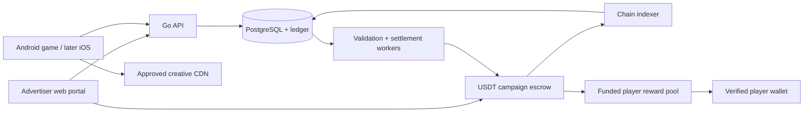

# Feature Spec: AdWeb3 advertising and player rewards

- **Slug:** `adweb3-platform`
- **Status:** Awaiting answers — proposed design, not authorization to implement
- **Author:** Codex with product owner
- **Date:** 2026-10-19

## 1. Summary

Companies buy advertising in the platform's games using USDT, and a defined share of earned advertising revenue funds player rewards. A shared Go backend selects ads, measures eligible delivery, authenticates app installations and wallets, and settles rewards. Games remain playable offline, while the pilot uses validated online activity to award points and distribute USDT; a tradable platform token is deferred by the owner's explicit choice.

**Problem it solves:** Provide one auditable funding, ad delivery, identity, and reward system across multiple games without promising more cash than advertisers have actually funded.

**Confirmed:** Go backend; Android first, iOS later; company-funded USDT vault; automatic reward allocation/distribution; wallet ownership verification; expiring campaigns; offline gameplay; online monetary earning; points/USDT pilot before a platform token; 30% player / 60% operating / 10% contingency allocation (confirmed 2026-10-19). Apply the split to earned net revenue as defined below, not refundable deposits.

**Confirmed decisions updated 2026-10-19:** Android replaces iOS as the first platform. The publisher SDK has free access and a 20% AdWeb3 commission on accepted earned net advertising revenue; ordinary partner apps retain 80%. These are owner-approved product choices, not evidence of signed publisher contracts. The optional partner player-reward allocation, publisher-beta delivery scope, and remaining contractual details are still proposals.

**Proposals, not yet approved:** A bounded Android adaptation of Candy Blocks as the first game; Avalanche C-Chain with native USD₮; contextual sponsor cards; daily reward processing; an initial 5 USDT CPM price and 25 USDT prepaid test budget with a seven-day serving window, actual-delivery billing, and unused-budget refunds. This pricing recommendation supersedes the earlier equal-share sponsorship suggestion; it is not yet an approved commercial contract. Sections below distinguish recommendations from confirmed choices. A [draft implementation plan](implementation-plan.md) has been written at the owner's request. It records explicit planning assumptions and separates the testnet pilot from the later publisher beta; it is not authorization to implement or launch.

## 2. Requirements

The confirmed platform and commercial decisions above govern this draft; detailed acceptance targets below remain pending full spec approval. A priority describes the applicable delivery scope, not a claim of user approval. FR-13–FR-16 and NFR-07–NFR-08 belong to the later external-publisher beta; only the reusable one-app SDK foundation is proposed for the grant pilot.

### Functional

| ID | Requirement | Priority |
|----|-------------|----------|
| FR-01 | An advertiser can purchase an approved campaign on an allowlisted chain/token; only a finalized, correctly attributed payment enables scheduling. Replayed payment events cannot credit it twice. | Must |
| FR-02 | Each campaign records app/placement eligibility, UTC start/end, purchase terms, creative approval, allocation version, and delivery/refund policy. End is exclusive. | Must |
| FR-03 | Ad decisions include only funded, approved, unpaused campaigns where start <= server time < end; no-fill is returned when none qualify. Selection follows sold shares, pacing, and frequency limits. | Must |
| FR-04 | Delivery ingestion distinguishes served, rendered, viewable, completed, and clicked events from game playtime; duplicates, invalid sessions, and implausible sequences do not earn credit. | Must |
| FR-05 | Offline gameplay persists locally and can sync as progress; monetary eligibility requires a current online reward session and timely validated events. Unverified offline history is never converted automatically into cash rewards. | Must |
| FR-06 | App instances enroll with a device key and server-verified platform integrity evidence; API credentials are short lived and bound to app and installation, plus the player when a reward account is used. An app identifier alone grants no reward authority. | Must |
| FR-07 | Wallet linking uses a single-use, expiring, domain-bound signing challenge; ownership verification is bound to the initiating player/session. Wallet changes require new proof and cannot redirect existing approved payouts. | Must |
| FR-08 | A settlement epoch allocates at most its funded player budget among validated points; the server displays pending points, finalized USDT entitlement, and paid amounts separately. | Must |
| FR-09 | Campaign escrow, player reward liabilities, operating funds, and contingency reserves are distinct ledger accounts; refundable deposits cannot be spent on payouts. Allocation percentages are snapshotted per purchase. | Must |
| FR-10 | A retryable payout worker pays verified eligible wallets with a unique payout ID; submission, confirmation, failure, and replacement are tracked without double payment. Minimum payout, cadence, and gas policy are visible. | Must |
| FR-11 | Advertisers can see purchased terms, delivery and invalid traffic adjustments; operators can approve creatives, pause campaigns/rewards, and reconcile ledger balances with chain balances. | Must |
| FR-12 | Rewards and campaign eligibility can be configured by app and permitted market; enabling real-money operation requires recorded store-policy and jurisdiction decisions. | Must |
| FR-13 | An operator approves a publisher organization and its verified app ownership, bundle/package ID, signing identity, placements, and payout destination before external paid inventory is enabled; suspension prevents new paid decisions. | Must — publisher beta |
| FR-14 | A versioned SDK requests contextual ads and reports delivery with server-bound publisher/app/placement/decision IDs, expiry, and idempotent events; modifying client identifiers cannot reattribute revenue. Wallet/reward functions are optional and disabled by default for external apps. | Must — publisher beta |
| FR-15 | SDK access is free; ordinary partner inventory allocates 80% of accepted earned net revenue to the publisher and 20% to AdWeb3, with no second commission. Accepted delivery creates publisher liabilities under the snapshotted commercial agreement; statements show gross delivery charges, permitted deductions, all allocation shares, holds, adjustments, payable balance, and payout status. Settlement and retries cannot exceed backing or pay twice. | Must — publisher beta |
| FR-16 | Advertisers explicitly approve eligible publisher inventory and whether player incentives apply; serving rejects unapproved inventory or incentive modes. Reward funding stays attached to its original app/campaign cohort. | Must — publisher beta |
| FR-17 | The Android pilot provides one bounded playable Candy Blocks candidate slice, local progress save/resume, and a reusable SDK integration with Home/results sponsor placement; existing iOS source is reference material, not claimed Android implementation. Exact game content remains subject to plan approval. | Must — pilot |
| FR-18 | Reuse the existing Nuxt frontend as the public landing page and advertiser/player dapp. Connected campaign, wallet and balance flows use the Go API as authority, enforce account ownership, and clearly distinguish preview data from actual indexed funding, delivery and payouts. | Must — pilot |

### Non-functional

| ID | Requirement | Priority |
|----|-------------|----------|
| NFR-01 | Monetary calculations use integer token units, explicit rounding, immutable ledger entries, and transactional uniqueness constraints; tests cover concurrent ingestion and settlement. | Must |
| NFR-02 | Failure of ads, attestation, or rewards preserves offline gameplay but cannot create unvalidated reward credit or fresh paid ad delivery. | Must |
| NFR-03 | Private keys/seeds are never requested from players; privileged signing is isolated from the public API; sensitive payloads are excluded from logs and all admin fund actions are audited. | Must |
| NFR-04 | Every finalized reward is traceable to an epoch, funding allocation, validation version, and payout transaction; every advertiser charge is traceable to purchased terms and delivery evidence. | Must |
| NFR-05 | Proposed pilot target: ad decisions p95 <= 250 ms at 100 requests/s in the deployment region, excluding asset download; load-test environment and data size are recorded. | Should |
| NFR-06 | Before paid launch, retention and deletion rules cover identifiers, wallet links, device evidence, raw events, and financial records; deletion tests honor required financial retention. | Must |
| NFR-07 | Publisher roles, API credentials, queries, event ingestion, reports, assets, and payouts enforce tenant boundaries; cross-tenant negative tests return no protected data and cannot alter another tenant's balances. | Must — publisher beta |
| NFR-08 | SDK delivery includes a versioned package, integration example, data inventory/privacy documentation, support policy, and consent controls. Tests cover disabled rewards, denied consent, server outage, bounded event queues, and expired decisions without blocking gameplay. | Must — publisher beta |
| NFR-09 | Every contract-bearing development/release candidate undergoes internal review using updated, revision-pinned Nemesis and Pashov Solidity Auditor skills; reports bind to source revision, confirmed findings receive regression tests/fixes and both-tool retest, and the review gate closes only with no unresolved MUST-FIX/SHOULD-FIX. Independent pre-mainnet review remains required. | Must |

## 3. Current State

- **Investigated root:** `/Users/homer/development/evm/AdWeb3` contains `.claude/skills/feature-request/` and no product source, manifests, migrations, tests, or Git metadata at inspection time.
- **Verified files:** `.claude/skills/feature-request/SKILL.md`, `feature-spec-template.md`, `implementation-plan-template.md`, `code-review-checklist.md`, and `README.md` are workflow documents, not application code.
- **Architecture / conventions:** None established. Proposed architecture below is a design decision to confirm, not an existing implementation.
- **Test framework / command:** None installed or executable for the product. Proposed Go verification after scaffolding: `go test ./...` and `go test -race ./...`; contract and client test commands depend on the selected toolchain. Do not report these as passing today.
- **Dependencies:** None declared. Versions and blockchain libraries will be selected and verified during planning.
- **Skill maintenance:** The personal skill and project copy now continue through all approved phases and reconcile implementation against the spec and plan. Initial spec/plan decision gates remain.

**Existing mobile portfolio inspected on 2026-10-19:** AdWeb3 is greenfield, but the owner identified `/Volumes/Dock 4TB/Development - Dock/hobby/personal/apps` as containing existing apps. Read-only inspection found `candy_tetris`, `train_chaos`, `farm_land`, `ages_of_time`, and `photo_drawing`. Their READMEs describe working product code; no build, device playtest, analytics, or current store-state check was performed in this investigation. No mobile repository was edited.

- `candy_tetris/README.md`: Candy Blocks, SwiftUI/SpriteKit, 30 campaign levels plus Endless, offline saves; sponsor cards deferred.
- `candy_tetris/Packages/CandyBlocksCore/Sources/CandyBlocksCore/Hybrid/GameEngine.swift`: existing seeded, tick-indexed deterministic game engine, useful for future replay validation. Determinism does not detect human versus bot play by itself.
- `candy_tetris/docs/features/candy-blocks/feature-spec.md`, section 2.N: later sponsor cards on Home/results, never over the live boards. Existing approved game scope defers ads and assumes bundled content; a remote ad feed and monetary rewards would be an explicit new change, not an already approved integration.
- `candy_tetris/docs/features/candy-blocks/HANDOVER.md`: documented engineering progress with remaining human/device/release gates. Historical reported test results were not rerun and are not fresh evidence.
- `train_chaos/README.md`: native SwiftUI/SpriteKit action game with a deterministic integer core; useful second candidate.
- `farm_land/README.md`: native Swift farming simulation; passive progression makes monetary activity attribution less straightforward.
- `ages_of_time/README.md`: Godot strategy game with a deterministic rules core; broader game/content scope than needed for the first ad experiment.
- `photo_drawing/README.md`: Flutter drawing app with offline photo processing; open-ended creative activity is harder to validate for cash rewards.

**Android readiness:** The inspected Candy Blocks implementation is SwiftUI/SpriteKit; no working Android Candy Blocks build or Android AdWeb3 SDK has been verified. Its game design and deterministic rules are reference material, not a drop-in Android library. Android adaptation and device validation must be included in the integration scope and estimate.

## 4. Gaps

### BLOCKING

These decisions remain open. At the owner's explicit request, the implementation plan is drafted conditionally; its assumptions do not resolve these gaps or authorize real-money operation.

| ID | Question | Why it blocks |
|----|----------|---------------|
| GAP-B01 | Android first is confirmed. Which launch countries and player age group, and what permitted Google Play reward product/distribution flow will be used? | Determines permitted reward design, distribution, identity obligations, and data policies. Android does not establish policy approval; tokenized-asset disclosures and applicable real-money rules still require assessment. |
| GAP-B02 | Accept the proposed 5 USDT CPM, 25 USDT budget, seven-day actual-delivery campaign and unused-budget refund model? What dispute/fraud-adjustment window applies? | Determines purchase contract, revenue release, refunds, and pacing. Price and billing unit remain proposals to validate with actual advertisers. |
| GAP-B03 | What actual daily audience, recruitment plan, and monthly operating budget should replace the explicitly hypothetical scenarios? | 30/60/10 is now confirmed. Without measured demand/inventory/costs, reward attraction and viability remain unproven. |
| GAP-B04 | Confirm a bounded Android Candy Blocks adaptation and Avalanche C-Chain/native USD₮, or select another Android game/network. Re-estimate the Android client/SDK work before approving the grant budget and timeline. | Candy Blocks is an existing iOS reference, not a verified Android integration. Game scope and the proposed USD 7,500/eight-week estimate are not yet approved or validated for Android. Supported wallets and funding/withdrawal routes still need integration verification. |

### NON-BLOCKING

| ID | Assumption / proposed default | Impact if wrong |
|----|-------------------------------|-----------------|
| GAP-N01 | One owned game proves a reusable SDK adapter in the grant pilot; external publisher onboarding and settlement follow in a separately scoped beta. Free SDK access and 20% AdWeb3 commission are confirmed; ordinary partner apps retain 80%. | Requiring a public publisher product in the first release changes the budget, milestones, and implementation plan. Remaining publisher contractual details and any optional player allocation must be agreed before its beta plan is approved. |
| GAP-N02 | Contextual ads only; no behavioral cross-app targeting or advertising-ID dependency in the pilot. | Additional consent, tracking controls, and data flows need specification. |
| GAP-N03 | Free gameplay, no paid entry, wagering, random monetary prizes, or paid earning boosts. | Changes store/legal classification and reward economics; requires a new product decision. |
| GAP-N04 | Proposed daily settlement processing with a fraud hold and thresholded automatic payout. Daily processing does not guarantee daily finalization/payment; funding must first clear the purchased refund/dispute conditions. Precise operational intervals/thresholds are selected from chain cost and risk tests. | Earlier payouts require separate platform prefunding and an explicitly approved risk policy. |
| GAP-N05 | A player may link the same account to multiple owned games through explicit authentication; app sessions remain audience-scoped. | Isolated game identities require an account-linking or balance-merging design. |

**Resolved during discussion:** Tradable token deferred; pilot uses points plus USDT. Monetary earning requires online validation; offline progress still syncs. Android is first, replacing the earlier iOS choice; the owned-game split is 30/60/10. Free publisher SDK access and 20% commission are confirmed. How long a brief network gap may remain eligible is an explicit technical policy to choose and test, not permission for unrestricted offline earnings.

## 5. Impact Analysis

| Dimension | Impact |
|-----------|--------|
| Files and modules changed | Greenfield product. Proposed module names below are design candidates; no corresponding source paths exist yet. Existing workflow files are maintained separately. |
| API / contract changes | New versioned mobile API, advertiser/admin API, funding/settlement contracts, and payout event schemas. No existing consumers to migrate. |
| Data model and migrations | New relational schema for advertisers, publisher organizations/memberships/agreements, publisher balances/statements, apps, placements, campaigns, creatives, orders, chain events, installations, players, wallet links, sessions, ad decisions, delivery events, ledger entries, epochs, and payouts. |
| Backwards compatibility | Mobile clients will lag server updates: version APIs/event schemas and retain supported client behavior. |
| Performance | Assets go through CDN; API returns metadata/decisions; batch telemetry and bound queries. Initial workload target is a proposal. |
| Security | Untrusted clients, reward farming, forged wallets, signing links, creative content, chain reorgs, privileged signing, and treasury withdrawals are distinct trust boundaries. |
| Testing surface | Economic invariants, identity replay, campaign boundary timing, fair selection, offline transitions, fraud rejection, ledger transactions, payout retry/reorg handling, and end-to-end reconciliation. |
| Affected consumers | Advertisers, players, owned mobile game teams, third-party app publishers, finance/support, contract operators. |

### Contract development and internal audit

The owner requires Foundry-based contract development plus updated Nemesis and Pashov skill reviews from `/Users/homer/development/audits/capyfi-smart-contracts/audit/tools`. Follow the [contract-audit runbook](../../runbooks/contract-audit.md): pin tool/source revisions, independently run both workflows, retain reports, fix verified findings with Foundry regressions, and retest both. Apply this at escrow/distributor development, contract-affecting changes, and final pilot/full-feature candidates. No AdWeb3 contract audit has run at this specification stage.

**Web frontend decision, confirmed 2026-10-19:** Reuse `frontend/`, the Nuxt 4/Vue design created by the owner's other coding session, for landing, advertiser dapp and player views. Its inspected server currently contains Nitro in-memory campaigns/sessions and sample rewards. Those are preview implementations, not the authoritative financial system. Integrate its server routes as a session-aware backend-for-frontend over Go; use Go-issued order IDs/terms and indexed balances/status. Preserve the visual design. Frontend build/runtime verification and permission/ownership tests are part of the pilot. The simple Go campaign page may remain a development/operator fallback.

### Proposed infrastructure

Use one modular Go service initially, with API and worker processes built from the same codebase. Modules: identity, apps, campaigns, delivery, event validation, ledger, settlement, chain indexing, and payouts. PostgreSQL is the source of truth; object storage/CDN hosts approved creatives. Start asynchronous jobs with a PostgreSQL transactional outbox; add Redis only for measured caching/rate-limit needs. Avoid initial microservice/Kafka/Kubernetes complexity.

Mobile games use a shared protocol and thin SDK adapters for networking, wallet linking, local event queues, and ad rendering. Proposed first SDK implementation is Kotlin for Android, with Google Play Integrity and Android wallet/app-link handling; engine choice remains open. Swift/iOS support is later scope. Kotlin is an implementation recommendation, not an existing package. Add games through registered app IDs, approved package/bundle identifiers, signing identities, placements, creative formats, and game-specific event validation.

The arrows from workers to contracts are authenticated transactions. A contract cannot independently observe gameplay, wake up on a date, or discover off-chain ad delivery. Automatic allocation requires a transaction trigger and an explicitly trusted settlement process. A public chain records payment; it does not prove a human viewed an ad.

### Funding and economics

1. Advertiser purchases terms using USDT; escrow records campaign/order and the versioned split. Verify chain ID, approved token address, actual received amount, payment identity, and finality. A token ticker alone is not identity. Select supported deployment addresses from the [issuer's protocol list](https://tether.to/en/supported-protocols/).
2. The deposit is a campaign liability until the relevant advertising obligation is earned. A refundable prepayment is not available profit or player funding. Tax/invoice treatment must follow the selected market.
3. Settlement releases only the accepted earned portion into player, operating, and contingency accounts. These can be internal contract balances or separate contracts; the refund backing must remain protected either way.
4. Earned player funding is reserved for reward epochs. Neither the treasury nor a later campaign may spend an existing player entitlement. Contingency reserves are separate from full backing for still-refundable advertiser funds.
5. Allocation changes affect new purchases; existing campaigns keep their purchased terms. Corrections use compensating ledger entries and explicit policies, never silent history edits.

Define **R** as earned advertising revenue after applicable taxes, refunds/credits, and explicitly agreed pass-through deductions. Define reward share **r**, contingency share **b**, operating costs **C**, and desired surplus **M**. Feasibility requires `R * (1 - r - b) >= C + M`; equivalently `r <= 1 - b - (C + M)/R` when R > 0. A reserve allocation is not a substitute for recognizing actual expenses; reconcile costs separately and avoid counting a deduction twice.

Illustration only, assuming **10,000 USDT of earned net revenue** and a 10% contingency allocation:

| Player share | Player pool | Contingency | Left for operating costs and surplus |
|--------------|-------------|-------------|-------------------------------------|
| 30% | 3,000 | 1,000 | 6,000 |
| 50% | 5,000 | 1,000 | 4,000 |
| 70% | 7,000 | 1,000 | 2,000 |

Confirmed initial allocation for owned games: 30% to players, **60% operating allocation plus 10% contingency**. This is an initial commercial choice, not an industry benchmark or proven optimum. At 6,000 USDT costs, the 30/60/10 illustration has no surplus. At 70% players, the same costs would exceed the operating allocation by 4,000 USDT.

At an illustrative 5 USDT per thousand valid impressions, ten impressions generate 0.05 USDT revenue; a 30% share is 0.015 USDT for players before any further agreed deductions. This is arithmetic, not a market eCPM claim. It shows why the games need entertainment value and why fixed wages per minute are unsafe. Validate advertiser renewal, valid-delivery rate, retention, fraud loss, payout cost, and acquisition cost before increasing the share or scaling the game portfolio.

### Publisher SDK and commercial model (decisions updated 2026-10-19)

Advertisers pay for campaigns; publishers supply apps and audiences. The SDK should serve ordinary apps as well as games. Confirmed: **free SDK access plus 20% of accepted earned net ad revenue** initially. Charging publishers before fill and earnings are demonstrated creates an adoption cost without a proven return. This is the owner-approved starting price to validate with publishers, not a market benchmark or a signed customer agreement. Revenue share alone still needs enough volume to cover sales, hosting, fraud, support, and payout costs.

| Model | Decision / scope | Reason |
|-------|------------------------|--------|
| SDK subscription plus commission | Defer | Difficult to justify before meaningful demand and publisher earnings exist. |
| Free SDK, 20% revenue share | Confirmed | Publisher and platform earn when accepted ad delivery earns revenue; no charge for no-fill requests. |
| Optional paid services | Later | Charge separately for dedicated support, service guarantees, or a publisher's own direct-sales tooling if demand is validated. No mandatory access fee proposed. |

Apply one allocation to **R**, the earned net revenue defined above, with only explicitly agreed deductions. Do not deduct AdWeb3's commission before applying the table, or charge it a second time. Contracts and statements must disclose taxes, refunds, invalid-traffic adjustments, and any pass-through costs. Hosting and normal sales/support costs are borne from AdWeb3's allocation unless separately agreed; they are not invisible deductions.

| Inventory / mode | Players | Publisher | AdWeb3 operations | Contingency |
|------------------|---------|-----------|-------------------|-------------|
| Owned games — confirmed | 30% | — | 60% | 10% |
| Partner app, ordinary ads — confirmed | 0% | 80% | 20% | Within AdWeb3's 20% if retained |
| Partner game, optional player rewards — illustrative proposal | 30% | 50% | 20% | Within AdWeb3's 20% if retained |

Every row allocates exactly 100%; the partner reserve description is not an extra allocation. On 1,000 USDT of earned net revenue, ordinary partner inventory earns the publisher 800 and AdWeb3 200 before its costs. In the optional reward example, players receive 300, the publisher 500, and AdWeb3 200. The owned-game 30/60/10 remains unchanged. Partner/player payable balances and unearned advertiser escrow are fully backed independently of any platform reserve.

At an illustrative net CPM of 5 USDT, 100,000 accepted partner impressions earn 500 USDT, of which AdWeb3 gets 100 and the publisher 400 without rewards. Thus 1,000 USDT/month of platform allocation requires one million accepted impressions/month before operating costs. More apps expand inventory, not advertiser demand: adding publishers without more spend can reduce fill. The SDK cannot by itself make per-player rewards larger.

**Delivery boundaries:**

1. Grant pilot: extract the one-game networking/decision/event adapter into a reusable SDK foundation, demonstrate it inside the selected game, and provide an integration example, versioned interface, and data-flow notes. Android is the confirmed first platform, with Kotlin proposed for the SDK. The candidate Candy Blocks client needs a bounded Android adaptation; include that work in the estimate. The old iOS integration estimate is not evidence that the Android deliverable fits the same budget or timeline. No claim of a production SDK or public publisher network.
2. Separately budgeted beta: integrate one approved external publisher using the same first-platform SDK, add organization roles, verified app ownership, inventory approval, tenant isolation, publisher ledger/statements, fraud holds/disputes, and authenticated payout setup. Before planning this beta, confirm any optional player-reward allocation, settlement asset/network, payout cadence/minimum, adjustment window, and supported app categories/markets. Proposed default is ordinary ads with no player rewards; publisher settlement in the same allowlisted USDT/network as campaign funding, with no fiat conversion service.
3. Expansion after measured demand: iOS SDK, then Unity/Flutter wrappers only for actual partner needs. A self-service portal, mediation, open bidding, and paid enterprise services are separate scope, not implicit SDK deliverables.

**SDK and backend responsibilities:** The Go service owns eligibility, decisions, attribution, validation, pricing, and settlement. Client events are evidence to validate, never authority to mint points or publisher credit. The SDK handles enrollment, rendering, bounded retry queues, consent state, and lifecycle/expiry behavior. Public app IDs and embedded SDK keys are identifiers, not secrets or proof of ownership. Bind enrollment to the registered package/signing identity and fresh integrity evidence; scope sessions and every decision to publisher/app/placement. Keep management credentials server-side, support rotation/revocation, and rate-limit per tenant. A kill switch stops new decisions; existing decisions remain bounded by their short lease and server-side billing validity.

Publisher payout setup requires authorized organization membership and proof of the receiving wallet, with an audited change process that cannot rewrite finalized payout destinations. Use a distinct publisher liability account, immutable agreement version and unique payout ID. Retain funds during the agreed fraud/dispute window. Disputes after final payment must follow a separately funded risk policy; never silently raid unrelated player/publisher balances. Mixed-inventory campaigns allocate each accepted delivery using its recorded inventory mode and agreement version. A change to terms requires a new version and any required advertiser acceptance, not retroactive repricing.

Rewards are optional: ordinary ad integration must not require an end-user wallet or reward account. Publisher/admin accounts are still required. Incentivized inventory is disclosed to advertisers; publisher apps cannot turn on monetary rewards themselves. Any reward-enabled integration needs a server validation contract for that game's eligible activity and app/market policy clearance. Pool contributions remain scoped to the originating campaign/app and eligible cohort; partner earnings do not subsidize owned-game players by default.

Use contextual placements and app-scoped identifiers by default, without cross-publisher targeting or shared advertising profiles. Supply SDK data-disclosure guidance and applicable privacy manifests; respect consent and applicable age/market restrictions. For later iOS support, Apple's rules require permission for relevant cross-company tracking and explain SDK data disclosures; a common wallet identifier must not become an undisclosed advertising identity graph. [Apple privacy and SDK guidance](https://developer.apple.com/app-store/user-privacy-and-data-use/). Third-party ad sources require their own contractual and reward-policy review: Google's rewarded-ad rules prohibit direct monetary rewards, so AdMob cannot be assumed to fill cash-reward inventory. [Google rewarded-ad policy](https://support.google.com/admob/answer/7313578?hl=en).

### First-game, chain, and pricing recommendation (2026-10-19)

**Game candidate: a bounded Android adaptation of Candy Blocks.** The inspected game is native SwiftUI/SpriteKit; the earlier claim that it was the smallest direct integration applied to iOS and is superseded by Android-first. Its finite rounds, deterministic rules, and Home/results sponsor-card design remain useful references. Proposed grant scope is one playable mode with a bounded ruleset, local progress, and one labeled sponsor placement; it excludes parity with all 30 levels, Endless, every asset/animation, and the full iOS release. No working Android port is asserted. Confirm the exact playable slice and estimate before planning; another verified Android game can replace this candidate only through an explicit scope update.

Keep offline gameplay and separate scores from money. Show the pilot sponsor card on Home or results, not as a forced retry gate. Validate Android lifecycle, foreground visibility, app-link return from a wallet, integrity checks, and disconnect/reconnect on a physical Android device. If deterministic rules are translated, use shared seeded command fixtures to compare results against the reference rules; reference Swift code is not assumed to run unchanged on Android. This is a proposed adaptation approach, not completed work or a user-approved game choice.

**Blockchain: Avalanche C-Chain with native USD₮**, one network only. Tether publishes its Avalanche USD₮ deployment at `0x9702230a8ea53601f5cd2dc00fdbc13d4df4a8c7`. C-Chain is EVM-compatible with chain ID 43114; it fits the Go/Solidity direction. Verify the token address, decimals, contract behavior, RPC/client block-hash compatibility, wallet support, and exchange withdrawal routes during planning. Gas is paid in AVAX; the platform should fund payout gas from the operating allocation. Receiving a payout need not require player-held AVAX, but subsequently moving funds from a normal wallet generally does. No fee quote or claim that it is the cheapest chain has been established. [Tether supported protocols](https://tether.to/en/supported-protocols/), [Avalanche integration guidance](https://build.avax.network/docs/primary-network/exchange-integration), [fee guidance](https://support.avax.network/en/articles/5521050-what-are-the-transaction-fees-on-avalanche)

Arbitrum One is a viable EVM alternative, but its relevant token is now USDT0, with additional cross-chain/attestation dependencies. Choosing native Avalanche USD₮ avoids introducing that representation into the first product; it does not eliminate issuer, chain, contract, or custody risk. Solana also has issuer-listed USD₮, but changes the custom-contract and wallet integration approach. Select by usable deposit/payout routes and measured batch economics, not headline transaction-fee marketing. [USDT0 on Arbitrum](https://usdt0.to/ecosystem/arbitrum)

**Trial advertiser offer:** 5 USDT per 1,000 validated viewable sponsor-card impressions; 25 USDT prepaid budget, allowing at most 5,000 billed impressions during a seven-day window. Bill actual valid delivery, cap spending at the budget, and refund unused funds after the agreed adjustment window. Example: 2,000 valid impressions cost 10 USDT and leave 15 USDT refundable. This is a deliberately small test quote, not evidence that advertisers will pay it. Test 3/5/10 USDT CPM sensitivity, then negotiate from actual audience/engagement and renewal data. Never use rewarded-video eCPM figures as a promised sponsor-card price. Appodeal's report called “2025” explicitly uses Q4 2024 data, which is another reason not to represent it as today's obtainable price. [Report methodology/date](https://appodeal.com/the-mobile-ecpm-report-updated-q4-2024/)

Seven days is the delivery window, not proof that 25 USDT was earned. No minimum traffic is promised until measured inventory supports it. Start with 1–3 design-partner advertisers; do not assume ten full budgets fit. With no measured audience, use house creatives and gather traffic evidence before selling guaranteed delivery. The chosen viewability threshold, per-user/per-creative frequency cap, and fraud adjustment rules must be in the advertiser terms. The incentivized nature of any permitted cash-reward audience must be disclosed.

**Reward sensitivity:** Let D be average daily active eligible players, A average ad opportunities per active player per day, F paid fill fraction, V accepted-valid fraction of filled opportunities, and C earned net CPM. Then daily valid paid impressions are `D*A*F*V`; daily revenue is `D*A*F*V*C/1000`; the player budget is 30% of that. The equal-activity illustrative reward per active-player day is `A*F*V*C*0.30/1000`. Individual allocation still follows the documented points weights. “Monthly per player” below assumes that same player participates with average activity on all 30 days; it is not revenue divided by monthly unique users.

All scenarios below are hypothetical; there is no measured audience, fill rate, accepted-valid rate, or advertiser demand yet. Revenue is assumed earned and net of contractual deductions, fees are funded by operations, and the dollar-equivalent illustration assumes USDT stays near USD 1. Opportunities are a model input, not a target for forced ad exposure.

| Scenario | Opportunities/player/day | Paid fill | Valid fraction | Net CPM (USDT) | Player/day (USDT) | Player/30 active days (USDT) |
|----------|--------------------------|-----------|----------------|----------------|-------------------|----------------------------|
| Initial illustration | 6 | 70% | 95% | 5 | 0.005985 | 0.17955 |
| Stronger demand | 6 | 80% | 95% | 10 | 0.01368 | 0.4104 |
| Aggressive sensitivity, not forecast | 10 | 90% | 95% | 20 | 0.0513 | 1.539 |

At the initial illustration and 1,000 daily players: 27,930 valid paid impressions/week; 139.65 USDT weekly earned revenue; 41.895 player allocation, 83.79 operating allocation, and 13.965 contingency allocation before token-unit rounding. Monthly operating allocation is only 359.10 USDT, before infrastructure, gas, support, sales, development, and acquisition costs. Increasing users raises total revenue but does not increase reward per player when all per-player assumptions stay constant.

For 0.10 USDT per active-player day at 6 opportunities, 80% paid fill, and 95% acceptance, required net CPM is about 73.10 USDT. At the initial 5-CPM illustration, accumulating even 1 USDT takes about 167.1 active days (168 whole days), before settlement holds. A 5-USDT minimum would take about 835.4 active days. This makes a high minimum withdrawal a poor retention proposition. Batch small payouts and measure cost, but do not promise a low minimum before proving it can be funded. Do not erase earned small balances to create margin.

**Attraction conclusion:** Current illustrative economics support a small loyalty bonus, not an income-led acquisition proposition. Whether even that bonus changes behavior is an untested product hypothesis. Validate enjoyment and repeat play first. Compare retention with sponsor cards against an ad-free baseline; if monetary rewards are permitted, compare the same ad load with/without a transparently funded reward and measure incremental retention, advertiser quality, fraud cost, and contribution after acquisition. Small initial interviews/playtests are directional, not statistical proof. Define target lift, sample size, and decision rules from the measured baseline before running a larger experiment. A separately budgeted promotional bonus can accelerate a test, but it must not be presented as sustainable ad earnings.

The Android pilot demonstrates enjoyable gameplay, direct sponsor cards, and the points/settlement flow using test assets. Real-money activation follows product-specific Google Play and market assessment; no automatic approval is assumed. The confirmed points/USDT product direction remains intact. Keep the 30% player allocation explicit in the model and do not promise redeemable points before confirming the product can deliver them.

### Points and settlement

Points are non-transferable accounting units for validated eligible activity. No fixed USDT value is promised while points are pending. For epoch e, a funded budget `B_e` and finalized eligible weights `w_i` give `reward_i = floor(B_e * w_i / sum(w))` in the selected token's smallest units. If total weight is zero, carry the budget forward under a disclosed policy. Keep rounding dust in the pool; never exceed B_e. Snapshot rules, eligible participants, weights, and funding before finalizing. Show estimated rewards separately from immutable finalized entitlements.

Recommended attribution rule: preserve validated weights by campaign, app/placement, and original activity cohort while its revenue remains pending. Once that revenue clears, allocate it to that original eligible cohort, even if finalization occurs days later. Daily jobs may validate and report pending activity without creating payable entitlements. Delayed campaign revenue must not silently enrich a later cohort, and a pending cohort must not be closed as a zero-reward epoch just because its funding has not cleared yet. Disclose the distinction between pending, rejected, finalized, and paid states. This recommendation is part of the proposed spec for approval.

Allocate budgets by app/placement or agreed campaign inventory before distributing to players; do not reward unrelated offline play from an advertiser's restricted campaign. Weights must come from validated eligible sessions and bounded ad exposure, not raw minutes or clicks. Set visible frequency and earning caps, detect concurrent farming sessions, and disclose to advertisers that the audience is incentivized. A signed device event is evidence of its source, not proof of a real human or attention.

Use a scheduled worker to pay only finalized entitlements to eligible verified wallets. Batch where economical, keep a gas budget, and retain sub-threshold amounts transparently. For an EVM pilot, a distributor can enforce unique payout IDs and approved epoch budgets; a permissioned relayer submits batches. An on-chain paid-ID check plus ledger uniqueness handles retries. Persist transaction intent/nonce/hash and reconcile finality before marking paid. A blocked/failing recipient must not prevent all other recipients from settling.

Later token design needs a separate decision: a market-traded token with no fixed redemption promise, or reserve-backed redemption with explicit liabilities and controls. Selling tokens on an AMM and redeeming them against a treasury are different products. Minting tokens cannot create USDT backing; a pool needs liquidity and suffers price impact. Do not build that exchange or promise a peg in the points pilot.

### Ad scheduling and measurement

Treat seven days as 168 hours from a purchased UTC start, unless different terms are explicitly selected. The eligibility predicate belongs in every decision request; a background expiry job is housekeeping, not the correctness mechanism. A campaign ending at time T is ineligible at T even if a worker is down.

For ten equally priced, equally eligible campaigns, each can receive approximately 10% of available opportunities under an explicitly sold equal-share package. If an eleventh joins, do not silently dilute a guaranteed share: reserve inventory at sale or sell a clearly stated variable share. Across multiple servers, naive in-memory round-robin does not enforce delivery fairness. Use persisted pacing/deficit counters, bounded frequency, and reconciliation against valid delivery; weighted selection supports unequal purchases.

An ad decision carries a unique decision ID, campaign/creative version, placement, asset URL, server time, and expiry no later than campaign end. The SDK checks validity before rendering; expired or uncertain ads yield no-fill or house content. For the pilot, paid ads are not newly displayed offline. Prefetching an asset does not authorize later display. Stop or clear a paid slot on lease expiry; reconnect for a new decision. No server can remotely remove a cached file from a modified disconnected device, so billable validity is enforced server-side too.

Track render and foreground visibility separately from game session duration. A playable session may contain no qualifying ad at all. Define viewable criteria by creative format before contracting; initial pilot may use a single static placement format to reduce measurement complexity. Metrics are fraud-filtered first-party measurements, not independently accredited viewability claims. Late delivery reports need a bounded grace window and valid server-issued session evidence; receipt after expiry is not automatically proof that rendering happened after expiry.

For guaranteed impression packages, underdelivery requires refund/credit or a separately agreed extension. For time/share sponsorship, terms must define outages, share shortfalls, and any minimum delivery. These financial remedies must be settled before allocating disputed revenue to irreversible rewards.

### Authentication and offline synchronization

There are three separate proofs: app installation integrity, control of a wallet, and reward eligibility. None proves the others.

1. **Installation enrollment:** App generates a per-installation key and submits server-challenge-bound evidence. Validate expected app/signing identity on the server. Use [Google Play Integrity](https://developer.android.com/google/play/integrity/overview) for the Android pilot where supported; [Apple App Attest](https://developer.apple.com/documentation/devicecheck/establishing-your-app-s-integrity) belongs to later iOS support. Treat integrity verdicts as risk signals; provide gameplay-only access if reward trust cannot be established. Never embed a universal secret in a distributed game.
2. **Wallet linking:** Player enters/connects a wallet. API creates an opaque, short-lived signing URL on the platform's HTTPS domain, bound to the initiating player and session. The page requests a human-readable authentication message, not a transfer or token approval. For EVM, follow [Sign-In with Ethereum](https://ercs.ethereum.org/ERCS/erc-4361): check address, signature, domain, URI, chain, nonce, issued/expiry times, and atomic single use. Contract wallets require their supported signature-verification path; either implement and test it or disclose pilot wallet limitations.
3. **Session completion:** A successful signature marks wallet ownership for that player. The initiating app exchanges a one-time result bound to its original session (with verifier/proof binding), rather than trusting a deep-link flag or possession of the URL. Issue short-lived audience-scoped access tokens and revocable rotating refresh credentials. A shared URL must not bind the victim's wallet to an attacker's account without clear wallet-holder confirmation and session binding.
4. **Reward session:** Online API grants a bounded session/lease. Proposed starting point for testing: send sequenced, idempotent batches every 15–30 seconds and use a short renewable lease. Exact windows are technical defaults to test. Bind batches to installation, app, player, session, decision IDs, and server-issued challenges. Cap elapsed credit and compare chronology/behavior on the server. Attestation does not eliminate bots; use caps, anomaly review, and delayed settlement.
5. **Disconnect:** Continue local gameplay, queue progress and telemetry, and show monetary earning as paused when eligibility is lost. A local queue supports reliable delivery, not entitlement creation. In the pilot, do not credit activity outside the accepted online validation window. Events from already validated online periods may retry idempotently within the configured late-delivery window. Device wall-clock time is never sufficient evidence.
6. **Reconnect:** Reauthenticate/renew the online session, upload progress separately from reward evidence, deduplicate, validate, and display accepted/pending/rejected results. Restart paid ads with a fresh decision. Cross-app limits operate on the server's player identity, not only the installation ID.

A wallet signature proves control of a key, not uniqueness of a human, absence of bots, age, jurisdiction, or eligibility for payment. Wallet recovery/change needs reauthentication and new proof; an already finalized payout keeps its original verified destination or follows an explicit cancellation/reissue process before submission.

### Policy constraints researched on 2026-10-19

**Later iOS expansion:** Apple guideline 3.1.5(v) prohibits cryptocurrency apps offering currency for completing tasks. Whether this exact game/reward design is accepted requires a product-specific determination; treat native iOS cash rewards as a launch risk. Moving redemption to a website or renaming a redeemable reward “points” does not establish compliance. Apple's ad and app-quality rules also matter for genuine games. [Apple App Review Guidelines](https://developer.apple.com/app-store/review/guidelines/)

iOS is deferred. Before any later iOS cash-reward release, resolve that product design using the exact reward/signing/redemption flow; neither preliminary feedback nor TestFlight availability guarantees App Store acceptance. Ordinary in-game rewards that cannot be cashed out are a different product and must not be substituted without owner agreement.

Do not assume AdMob rewarded video can fill unsold inventory for cash payouts: Google-served rewarded ads prohibit direct monetary rewards, including cryptocurrency, and require permitted indirect rewards to be non-transferable and not directly cash-convertible. This is separate from Apple policy. Direct advertiser contracts do not override store rules. [AdMob reward rules](https://support.google.com/admob/answer/7313578?hl=en-GB)

**Android-first launch:** Google requires disclosure when apps enable tokenized digital asset earning and prohibits promoting or glamorizing potential earnings from playing/trading. Its exchange/wallet and other real-money policies also apply where relevant. Android is not automatic approval for this design. [Google blockchain policy](https://support.google.com/googleplay/android-developer/answer/13607354?hl=en)

Google Play also restricts real-money wagering/staking and paid participation for monetary prizes. The proposed game has no paid entry or wagering. The gamified-loyalty provisions depend on qualifying monetary transactions and do not automatically authorize this advertiser-funded model. Confirm the exact product and launch markets before real-money operation. [Google real-money games policy](https://support.google.com/googleplay/android-developer/answer/9877032?hl=en).

If targeting the Netherlands/EU, assess issuance, custody, redemption/exchange, transfer, and stablecoin availability with qualified advice before real-money launch. AFM explains that proprietary exchange activity may require authorization; exact applicability depends on the service. User location and intended operating jurisdiction have not been inferred from the machine timezone. [AFM crypto-service FAQ](https://www.afm.nl/en/sector/cryptopartijen/contact-qa)

## 6. Risks

| ID | Risk | Likelihood | Blast radius | Mitigation |
|----|------|-----------|--------------|------------|
| RISK-01 | Bots or falsified activity extract rewards. | High | Player pool and advertiser trust | Online validation, app integrity signals, caps, delayed settlement, game-specific plausibility checks, fraud investigation. |
| RISK-02 | Refundable deposits are distributed prematurely. | High without escrow rules | Platform solvency | Separate liabilities; release only accepted earned funds; preserve full refund backing. |
| RISK-03 | Cash rewards conflict with store rules or regulated services obligations. | Material, unresolved | Distribution and business viability | Decide market/product scope before paid launch; independent policy/legal review; no assumed points workaround. |
| RISK-04 | Rewards are too small to retain users or leave no operating margin. | High until tested | Business | One-game paid pilot, sensitivity model, entertaining gameplay, measure renewal and contribution margin. |
| RISK-05 | Contract or signing compromise drains funds. | Med | Treasury/player liabilities | Minimal contracts, capped authority, multisig administration, isolated signer, pause controls, independent security audit before mainnet funds. |
| RISK-06 | Reorgs, retries, or concurrent jobs double-credit deposits/payouts. | Med | Financial correctness | Finality policy, unique chain-event and payout IDs, durable transaction state, deterministic reconciliation. |
| RISK-07 | USDT freeze/depeg or wrong-network assets disrupt settlement. | Med | Deposits/payout liquidity | Explicit supported asset/network, no assumed USD equivalence under stress, pause/reconciliation process and disclosed handling. |
| RISK-08 | Diluted shares, invalid impressions, or excessive ad load cause advertiser/player churn. | High until tested | Revenue and retention | Inventory commitments, fraud reporting, frequency caps, clear incentives and underdelivery terms. |
| RISK-09 | Wallet linking/session hijack redirects payouts; wallet farms evade caps. | Med | Players/reward pool | Domain/nonce/session binding, new proof for changes, account-level risk controls, audit trail. |
| RISK-10 | Partner fraud or a tenant-boundary failure misattributes revenue or exposes another publisher's data. | High until verified | Publishers, advertisers, liabilities | Verified onboarding, server-bound attribution, negative isolation tests, held settlement, independent review. |
| RISK-11 | SDK adoption grows inventory faster than advertiser demand. | High until tested | Publisher retention and platform margin | Free access, no guaranteed fill, one-partner beta, measure accepted revenue and support cost before expanding. |

## 7. Epics

### EP-01: Fund and fulfill campaigns
- **Goal:** Sell defined inventory, accept correct USDT funding, serve eligible ads, and report delivery.
- **Scope boundary:** Owned-game inventory first; external inventory uses EP-05 onboarding and settlement controls. No open ad exchange.

### EP-02: Authenticate players and validate activity
- **Goal:** Link trusted sessions and proven wallets to bounded online reward activity while preserving offline gameplay.
- **Scope boundary:** Installation integrity, wallet authentication, progress sync, and fraud controls; no claim that device or wallet identity proves one human.

### EP-03: Settle funded rewards
- **Goal:** Convert validated points to backed USDT entitlements and pay them once.
- **Scope boundary:** Escrow, ledger, fixed-budget epochs, and distributions; no speculative token issuance or exchange.

### EP-04: Operate and verify the platform
- **Goal:** Make financial reconciliation, service performance, policy configuration, and support actions observable and testable.
- **Scope boundary:** Pilot controls and launch evidence; no claim of external certification from internal tests.

### EP-05: Let external publishers earn from integrated ads
- **Goal:** Provide a reusable SDK and approved external inventory with transparent publisher compensation.
- **Scope boundary:** A one-app SDK foundation in the proposed grant pilot; the external-publisher beta is separately planned and budgeted. No mandatory publisher subscription, guaranteed fill, broad engine support, or automatic reward activation.

## 8. User Stories

### US-01: Purchase a campaign
- **Epic:** EP-01
- **As an** advertiser, **I want** a funded campaign with explicit terms, **so that** I know what inventory I bought.
- **AC-01.1:** Given an approved order and matching finalized USDT payment, when the indexer sees it twice, then one funding credit exists and the scheduled campaign keeps its purchased split and terms.
- **AC-01.2:** Given wrong-chain/token, short payment, or unfinalized funding, when activation is requested, then the campaign remains ineligible and the discrepancy is recorded.

### US-02: Deliver ads within purchased limits
- **Epic:** EP-01
- **As an** advertiser, **I want** eligible delivery during my campaign, **so that** paid inventory is fulfilled fairly.
- **AC-02.1:** Given ten equal-share eligible campaigns and sufficient eligible traffic, when deterministic scheduling tests simulate delivery, then each receives its contracted share within the configured tolerance, and no sale exceeds reserved inventory.
- **AC-02.2:** Given a campaign ending at T and a stopped expiry worker, when a request occurs at T, then it receives no decision for that campaign; the official client also rejects its expired cached decision.
- **AC-02.3:** Given paused/unapproved campaigns or no eligible ads, when the app requests a decision, then it receives no paid creative from those campaigns and gameplay continues.

### US-03: Measure valid exposure
- **Epic:** EP-01
- **As an** advertiser, **I want** actual delivery distinguished from playtime, **so that** reports support my purchase terms.
- **AC-03.1:** Given a session with background time, duplicate reports, and an invalid event sequence, when ingestion runs, then only qualifying unique events affect delivery/points and rejection reasons are auditable.
- **AC-03.2:** Given underdelivery, when campaign settlement runs, then the selected refund/credit rules apply before release of disputed funds; the report shows the adjustment.

### US-04: Authenticate app sessions
- **Epic:** EP-02
- **As a** player, **I want** a secure app session, **so that** another installation cannot claim my activity.
- **AC-04.1:** Given valid enrollment evidence bound to a fresh challenge, when registration completes, then app-scoped credentials bind the installation key and player; reused challenges and other-app credentials are rejected.
- **AC-04.2:** Given unsupported/failed integrity checks or an expired credential, when reward APIs are called, then no new monetary credit is created and offline gameplay remains available.

### US-05: Prove and maintain wallet ownership
- **Epic:** EP-02
- **As a** player, **I want** to sign a wallet-link message, **so that** payments go to a wallet I control without sharing secrets.
- **AC-05.1:** Given a valid bound challenge and signature from a supported wallet, when verified once, then only the initiating authorized player/session can complete the link; replay, wrong domain/chain, expired nonce, and wrong signature fail.
- **AC-05.2:** Given an attempted wallet change, when new ownership proof or reauthentication is missing, then the link stays unchanged; finalized payouts cannot silently change destination.

### US-06: Continue playing when disconnected
- **Epic:** EP-02
- **As a** player, **I want** offline gameplay and clear reward status, **so that** losing connection does not lose progress or promise unsupported earnings.
- **AC-06.1:** Given an active session that loses online eligibility, when gameplay continues, then local progress persists, paid ads stop under lease rules, and monetary earning is shown as paused.
- **AC-06.2:** Given reconnection and retried queued batches, when synchronization runs, then progress syncs independently, events deduplicate, eligible prior online events follow the bounded retry policy, and offline-only play receives no cash credit.

### US-07: Receive a funded reward
- **Epic:** EP-03
- **As a** player, **I want** transparent settlement, **so that** I can distinguish pending points from payable USDT.
- **AC-07.1:** Given a funded epoch and finalized eligible weights, when settlement runs concurrently twice, then one immutable entitlement set is created, rounding is deterministic, and total entitlements never exceed the budget.
- **AC-07.2:** Given no eligible weights or no funded budget, when settlement runs, then no unfunded entitlement is created; carry-forward and pending status follow the published policy.
- **AC-07.3:** Given validated campaign activity whose revenue clears after its activity day, when a later settlement job finalizes it, then the allocation uses its original stored eligible cohort and rules, not the later day's players; until then it remains visibly pending.

### US-08: Preserve advertiser and player backing
- **Epic:** EP-03
- **As an** operator, **I want** segregated liabilities, **so that** refunds and player payments remain funded.
- **AC-08.1:** Given a refundable prepayment, when an operating withdrawal or player allocation would consume its backing, then it is rejected; only accepted earned revenue can be allocated.
- **AC-08.2:** Given an allocation-policy update, when existing and new campaigns settle, then each uses its own purchased version; ledger debits and credits balance exactly in integer units.

### US-09: Pay entitlements exactly once
- **Epic:** EP-03
- **As a** verified player, **I want** automatic payouts, **so that** I do not need to submit a transaction for every small reward.
- **AC-09.1:** Given a threshold-eligible finalized entitlement, when submission times out and the worker retries or replaces the transaction, then reconciliation results in at most one successful payment for its payout ID.
- **AC-09.2:** Given an unverified wallet, insufficient gas, failing recipient, or nonfinal transaction, when the worker runs, then status stays accurate without dropping entitlement or marking it paid prematurely; eligible unrelated payouts can proceed.

### US-10: Operate a measurable permitted pilot
- **Epic:** EP-04
- **As an** operator, **I want** auditable controls and launch evidence, **so that** failures and policy restrictions are visible before scaling.
- **AC-10.1:** Given a campaign, ledger adjustment, or payout, when support follows its audit trail, then it can trace terms, funding, validation, and transaction state without exposing secrets.
- **AC-10.2:** Given an app/market without the required launch decision, when real-money rewards are enabled, then configuration rejects activation; advertiser and player-facing terms disclose the selected reward policies.
- **AC-10.3:** Given the proposed load-test setup, when 100 ad requests/s are sustained, then recorded p95 meets the 250 ms server target or the requirement remains unmet.
- **AC-10.4:** Given a player deletion request and the approved retention policy, when processed, then deletable records are removed/anonymized while required financial evidence is retained with restricted access and an audit entry.

- **AC-10.5:** Given a contract-bearing candidate, when its phase/final review is completed, then updated and pinned Nemesis and Pashov skills have reviewed the same recorded source revision, reports and coverage are retained, confirmed issues have passing regression/fix/retest evidence, and no unresolved MUST-FIX/SHOULD-FIX remains; an incomplete tool run cannot be labeled clean.

### US-11: Register and isolate publisher apps
- **Epic:** EP-05
- **As a** publisher, **I want** verified app registration and scoped access, **so that** only my organization manages my inventory and revenue.
- **AC-11.1:** Given an unapproved app or mismatched package/signing evidence, when enrollment or paid delivery is requested, then activation fails; a copied public app ID grants no authority.
- **AC-11.2:** Given publisher A credentials, when requests substitute publisher B app, decision, report, asset, or payout IDs, then protected data is not returned and no attribution or balance changes occur.
- **AC-11.3:** Given a suspended app, when new decisions are requested, then no paid decision is issued and old decisions cannot bill outside their validity.

### US-12: Integrate ads independently of rewards
- **Epic:** EP-05
- **As an** app developer, **I want** a documented versioned SDK, **so that** I can show approved contextual ads without requiring user wallets.
- **AC-12.1:** Given the integration example and a registered app, when the SDK requests an ad with rewards disabled, then it renders an eligible placement and reports bounded events without invoking wallet/reward enrollment.
- **AC-12.2:** Given outage, denied consent, a full retry queue, or an expired decision, when the SDK handles the condition, then gameplay continues, queue limits hold, and no prohibited collection or unauthorized credit occurs; replayed valid events credit at most once.
- **AC-12.3:** Given a released SDK package, when the integration is reviewed, then its version, supported platforms/API versions, data disclosures, required privacy metadata, and update/support policy are documented and match observed behavior.

### US-13: Settle publisher earnings transparently
- **Epic:** EP-05
- **As a** publisher, **I want** an itemized funded balance, **so that** I know how revenue shares and deductions produce my payout.
- **AC-13.0:** Given an approved ordinary publisher app with no paid subscription, when the SDK requests eligible inventory, then no access subscription is required and no-fill requests generate no fee.
- **AC-13.1:** Given 1,000 USDT of accepted net revenue on an agreed ordinary 80/20 contract, when settlement finalizes, then publisher liability is 800 and platform allocation 200; a platform reserve is funded within that 200 and all ledger entries balance.
- **AC-13.2:** Given refundable/disputed funds or an unsettled payout, when settlement retries or funds are withdrawn, then existing backing remains protected and a payout ID cannot pay twice; the statement distinguishes held, payable, and paid amounts.
- **AC-13.3:** Given an agreement or receiving-wallet change, when an existing allocation pays, then its snapshotted terms and finalized destination remain unchanged; a new destination requires authorized reauthentication and wallet proof.

### US-14: Control inventory and reward funding
- **Epic:** EP-05
- **As an** advertiser, **I want** to approve inventory and incentive conditions, **so that** my campaign runs under the purchased terms.
- **AC-14.1:** Given a campaign excluding a publisher or incentivized traffic, when that inventory requests an ad, then no campaign decision is issued even if the publisher changes client flags.
- **AC-14.2:** Given a permitted reward-enabled agreement allocating 30/50/20, when 1,000 USDT of accepted net revenue settles, then 300 funds that original activity cohort, 500 the publisher, and 200 the platform; delayed clearance cannot move funding to another app or later cohort.
- **AC-14.3:** Given an external app without approved game validation rules or market/store clearance, when cash rewards are enabled, then activation is rejected while ordinary ads remain independently configurable.

### US-15: Play the Android pilot game
- **Epic:** EP-02
- **As a** player, **I want** a playable Android game with durable local progress, **so that** I can enjoy the pilot without connectivity or a wallet.
- **AC-15.1:** Given the selected bounded game rules and seeded command fixtures, when Android executes the same valid inputs, then expected states/results match the reference fixtures; malformed input cannot corrupt the saved game.
- **AC-15.2:** Given an offline run and process restart, when the player resumes, then local progress is restored without requiring a wallet or network; unavailable ads/rewards do not block the game.
- **AC-15.3:** Given the first Android SDK integration, when the physical-device demo runs, then sponsor UI is confined to the approved Home/results placement, lifecycle/expiry behavior is verified, and package/SDK versions are recorded.

### US-16: Use the landing page and dapp
- **Epic:** EP-04
- **As a** visitor, advertiser or player, **I want** the existing Nuxt design to provide product information and authenticated campaign/reward views, **so that** the web experience reflects actual account activity.
- **AC-16.1:** Given an unauthenticated visitor, when the landing page loads, then it renders without a wallet; private dapp routes require a bound authenticated session and previews are explicitly labeled.
- **AC-16.2:** Given an authenticated advertiser, when a campaign is created/funded/reported, then Go-issued order IDs and terms, indexed finality, ownership and accepted delivery determine its status; another account cannot read or change it.
- **AC-16.3:** Given a player session, when balances/payouts are displayed, then pending, finalized and confirmed-paid states come from the Go ledger; sample transactions are never presented as live payments.
- **AC-16.4:** Given server secrets and untrusted browser requests, when the Nuxt server proxies a request, then credentials remain server-side and client-supplied actor, funding, status or reward fields cannot grant authority.

### Traceability

| Requirement | Covered by |
|-------------|------------|
| FR-01 | US-01 |
| FR-02 | US-01, US-02 |
| FR-03 | US-02 |
| FR-04 | US-03 |
| FR-05 | US-06 |
| FR-06 | US-04 |
| FR-07 | US-05 |
| FR-08 | US-07 |
| FR-09 | US-08 |
| FR-10 | US-09 |
| FR-11 | US-02, US-03, US-10 |
| FR-12 | US-10, US-14 |
| FR-13 | US-11, US-13 |
| FR-14 | US-11, US-12 |
| FR-15 | US-13 |
| FR-16 | US-14 |
| FR-17 | US-15 |
| FR-18 | US-16 |
| NFR-01 | US-01, US-03, US-07, US-08, US-09 |
| NFR-02 | US-02, US-04, US-06 |
| NFR-03 | US-04, US-05, US-10 |
| NFR-04 | US-03, US-10 |
| NFR-05 | US-10 |
| NFR-06 | US-10 |
| NFR-07 | US-11 |
| NFR-08 | US-12 |
| NFR-09 | US-10 |

**Unmapped requirements:** None. Detailed thresholds/policies remain proposed or explicitly blocked above; traceability is not evidence that implementation exists.

## 9. Out of Scope

- Product implementation or scaffolding before the spec decisions and implementation-plan approval.
- Tradable platform token, token sale, AMM liquidity, fixed token redemption rate, or exchange in the pilot.
- Monetary credit for unrestricted offline play, guaranteed hourly income, or paying simply for app-reported minutes.
- A public publisher marketplace or full external-publisher settlement within the current mini-grant pilot; external publishers are now a planned extension under EP-05, not a permanent non-goal.
- Real-time bidding exchange, behavioral targeting, multi-chain bridges, immediate multi-game launch, or simultaneous support for every engine/platform.
- iOS SDK delivery in the Android pilot, or full Android feature/content parity with the existing iOS Candy Blocks game.
- Paid entry, wagering, randomized cash prizes, or purchasing boosts to increase cash earnings under this draft.
- Mainnet launch without independent contract/security review and the required market/store determinations.
